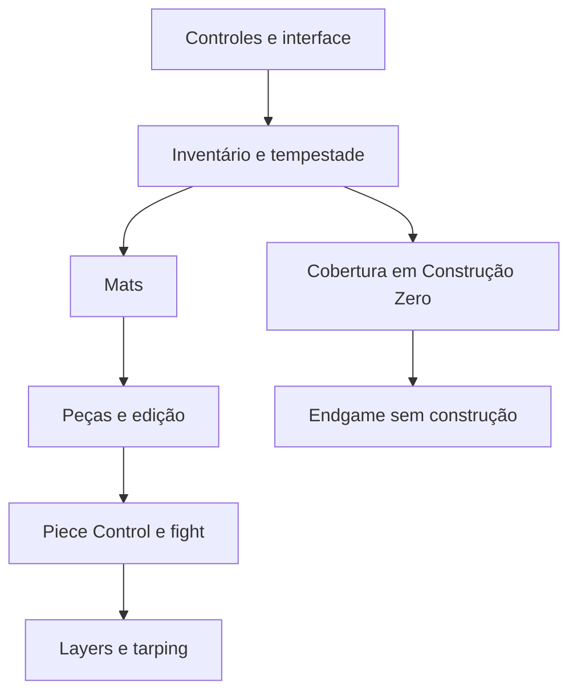

# Currículo incremental e mapa de pré-requisitos

## Modelo

Reutiliza `articles` e sua administração, RLS de publicação, histórico `content_revision_history`, datas e URLs. `curriculum` é uma coluna JSONB opcional; registros antigos não precisam dela. Campos tipados: versão, domínio extensível, nível 0–5, modalidades, experiência (BR/Reload/compartilhada), fase, pré-requisitos por slug, objetivos, critérios de avaliação, IDs de exercícios/competências existentes, classificação editorial, escopo do meta e fontes com natureza/acesso/alcance. Não duplica catálogo, glossário ou dados privados em novas tabelas.

Aulas são cadastráveis/editáveis no CMS sem criar componentes ou rotas por registro. Em Administração → Notícias e aulas, crie uma aula e use “Adicionar estrutura curricular”. O editor estrutural é JSON para curadoria administrativa; a página do jogador apresenta rótulos e atividades legíveis. Substitua texto/fonte de exemplo, revise a aula, mantenha `valid_until`, salve como rascunho e publique após revisão. Domínios podem ser ampliados sem alterar enumeração. Competências e evidências do catálogo científico continuam versionadas em migrations/PRs; não são livremente alteráveis pelo CMS.

### Validação

Cliente: Zod estrito, limites, HTTPS, enums, arrays sem duplicatas, prazo obrigatório, rejeição de auto-dependência; `prerequisiteIssues` sinaliza dependência ausente, ciclo e modalidade incompatível. Servidor: valida novamente forma/tamanhos/fontes, existência e compatibilidade de exercícios/competências, dependências, publicação e ciclos. Alterar modalidade, slug, publicação ou excluir um pré-requisito não pode quebrar aulas dependentes. Um lock de tabela em trigger de statement serializa as raras mutações editoriais do grafo. A concorrência multiconexão ainda requer homologação PostgreSQL/Supabase real; PGlite verifica semântica das operações sequenciais.

Publicação/revisão não significa eficácia científica. Retirar um exercício pode deixá-lo indisponível na aula; a interface informa isso, preservando a aula e registros históricos. Prazo encerrado sinaliza revisão pendente. Textos são renderizados como texto React, sem HTML de terceiros ou execução de instruções. Fontes não são buscadas automaticamente. Projeção `retrieveCurriculum` limita três aulas/3.000 caracteres por aula, inclui origem, escopo e vencimento, marca `reference-data-only`; não recebe perfis privados e não conecta um provedor generativo nesta versão.

## Progressão e dependências

Níveis são editoriais e não bloqueiam estudo. Abertura direta permanece permitida; ler uma aula não concede XP, conclui uma meta ou certifica domínio.

O grafo acima é um recorte. O mapa completo é gerado do arquivo canônico e registrado em COVERAGE.md. Pré-requisitos são relações pedagógicas, não requisitos oficiais. A trilha sem construção não depende de mats ou edição. Reload compartilha bases e tem uma aula específica; não presume fila Trios. Equipe tem papéis flexíveis, não posições fixas.

## Rotas e desempenho

`/academy/curriculum` possui busca por todos os termos, filtros de nível/modalidade/experiência/fase e estados vazios. `/academy/:slug` preserva artigos existentes e exibe o contexto apenas quando válido. Atividades ligam aos detalhes reais de `/library/:id`; o construtor e execução continuam os existentes. Não há escrita automática ao ler.

Página e corpus local são carregados em chunks separados; com Supabase configurado, o catálogo vem do CMS autenticado/RLS, sem misturar seed na conta real. Sem backend e em demonstração, `mastery-catalog` fornece o seed público em carregamento assíncrono com tratamento de falha. Não adicionamos dependências. Pré-renderização editorial existente continua opcional; não foi habilitada sem ambiente real.

## Migrations

012 acrescenta e valida a coluna; 013 insere 19 aulas com IDs estáveis 2201–2219 e `ON CONFLICT DO NOTHING`, sem sobrescrever artigos editados. Gerador offline: `node scripts/mastery-seed.mjs`; conferência: `--check`. Migrations 001–011 intactas. Aplicar 012–013 apenas após elas em staging, com backup. Nenhuma migration remota aplicada nesta entrega.

Resultados e checklist: [VALIDATION.md](VALIDATION.md). O registro de evidências desta camada está em [RESEARCH.md](RESEARCH.md), com fontes exatas; o inventário e as dependências completas estão em [COVERAGE.md](COVERAGE.md). A pesquisa científica anterior e os protocolos de métricas permanecem inalterados.
